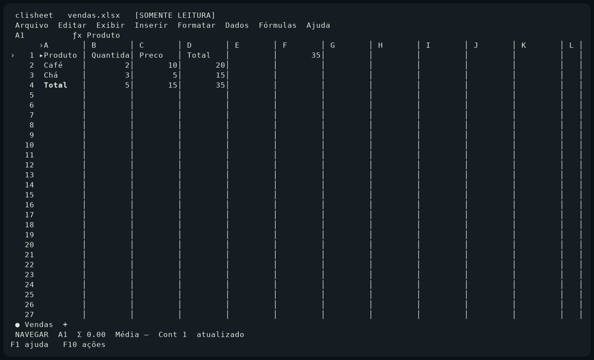

# clisheet

Editor de planilhas XLSX no terminal, escrito em Rust. Abre pastas com várias abas, recalcula fórmulas localmente e permite editar por teclado ou mouse. Para experimentar, use o exemplo de resumo. Ele tem duas abas e uma fórmula que depende do preço de um produto.

[](docs/media/clisheet-demo.mp4)

[**Assistir à demonstração em MP4 (27 s)**](docs/media/clisheet-demo.mp4) · Na tabela de vendas, mudar a quantidade de café de 2 para 4 recalcula o total de 35 para 55. O vídeo mostra a fórmula, a seleção de um intervalo, desfazer/refazer, a troca de tema e o resultado após salvar e reabrir o XLSX.

## Executar

Na raiz do projeto, com Rust 1.94 ou superior e Cargo disponíveis, execute os dois comandos abaixo. O primeiro build precisa de acesso às dependências do Cargo ou de um cache já preenchido.

```sh
cargo build --release --locked
./target/release/clisheet examples/xlsx/resumo.xlsx
```

Para instalar o comando na sua conta, execute `cargo install --locked --path .`. Com o diretório de binários do Cargo no PATH, use:

```sh
clisheet
clisheet examples/xlsx/orcamento.xlsx
clisheet examples/xlsx/vendas.xlsx --read-only
clisheet examples/xlsx/resumo.xlsx --sheet "Preços 2026" --no-mouse
clisheet --locale pt-BR --theme dark
clisheet --recover
clisheet --help
clisheet --version
```

## Abrir → editar → calcular → salvar → reabrir

1. Na raiz do projeto, execute `cp -i examples/xlsx/resumo.xlsx ./minha-copia.xlsx`.
2. Abra `./target/release/clisheet minha-copia.xlsx --sheet "Preços 2026"`. Digite `:ir B2`, pressione Enter, digite `15` e confirme com Enter.
3. Clique em **Resumo**, ou use `:aba-anterior` e Enter. A1 passa de **20** para **30**. Com A1 selecionada, a barra de fórmulas mostra `='Preços 2026'!B2*2`.
4. Pressione Ctrl+S, aguarde a mensagem de gravação e saia com Ctrl+Q. Execute `./target/release/clisheet minha-copia.xlsx --sheet Resumo --read-only`. Confira A1 novamente.

Em `vendas.xlsx`, D2 e D3 calculam quantidade × preço. D4 mostra o total da tabela e F1 soma a coluna por nome. Ambos começam em **35**. O exemplo `incompativel.xlsx` contém um gráfico e serve para experimentar **Salvar cópia**.

## Teclado e mouse

| Ação | Controle |
|---|---|
| Navegar e selecionar | Setas, Shift+setas, Ctrl+setas para bordas de regiões, Page Up/Down para páginas |
| Ir à primeira ou última coluna usada na linha atual | Home vai à coluna A, End à última coluna usada da aba |
| Ir ao início ou fim da área usada | Ctrl+Home, Ctrl+End |
| Avançar linha ou coluna | Enter, Tab e Shift+Tab |
| Substituir, editar, confirmar ou cancelar | Digitar, F2, Enter, Esc |
| Inserir quebra de linha no editor | Alt+Enter |
| Inserir referência em fórmula | Clique na célula ou use F4 e setas. Shift amplia o intervalo. Durante a fórmula, clique em outra aba ou use F6/F7 para referenciá-la |
| Limpar conteúdo mantendo o estilo | Delete |
| Abrir, salvar e sair | Ctrl+O, Ctrl+S, Ctrl+Q |
| Histórico | Ctrl+Z desfaz a operação inteira, Ctrl+Y refaz |
| Clipboard interno | Ctrl+C, Ctrl+X, Ctrl+V |
| Busca e endereço | Ctrl+F, Ctrl+G |
| Abas anterior e seguinte | Ctrl+Page Up, Ctrl+Page Down, ou clique na aba |
| Ajuda, comandos e recálculo | F1, F10, F5 |
| Seleção pelo mouse | Clique, Shift+clique ou arrasto. Cabeçalhos selecionam linha ou coluna |
| Editar e ajustar largura | Duplo clique na célula edita. Arrastar a divisória muda a largura, duplo clique ajusta ao conteúdo |
| Rolagem e menu de contexto | Roda, Shift+roda para horizontal, botão direito para ações |

O seletor de arquivos aceita caminhos digitados e navegação por diretórios. Use `:` para chamar uma ação sem depender dos atalhos do terminal. Exemplos de comandos:

| Digite e confirme com Enter | Resultado |
|---|---|
| `:ir B2:D10` | Seleciona um retângulo |
| `:preencher 15`, `:baixo`, `:direita`, `:serie 1` | Preenche a seleção ou continua uma série |
| `:formato percentual`, `:formato moeda`, `:formato personalizado #,##0.000` | Muda a apresentação |
| `:buscar formula SUM`, `:substituir seleção Café => Chá` | Pesquisa a aba ou substitui no escopo indicado |
| `:congelar` em C3 | Fixa linhas 1–2 e colunas A–B |
| `:ordenar cab A+,B-` | Ordena a seleção pelas colunas A e B, preservando o cabeçalho. Use `sem` para dados sem cabeçalho |
| `:filtrar B >10`, `:filtrar A ~café`, `:filtrar A vazio`, `:remover-filtro` | Aplica ou remove um critério na região com cabeçalho |
| `:tabela tbVendas` | Cria tabela a partir de seleção com cabeçalhos únicos |
| `:coluna-calculada =[@Quantidade]*[@Preco]` | Define a fórmula da coluna ativa da tabela |
| `:registro`, `:totais`, `:redimensionar-tabela A1:D8` | Acrescenta registro, alterna totais ou altera limites da tabela |
| `:nota Conferir preço`, `:ler-nota` | Escreve ou consulta nota na célula |
| `:colar valores`, `:colar formulas`, `:colar formato`, `:colar transpor` | Controla a colagem do bloco interno |

Colagens abrangem todas as posições do retângulo, incluindo linhas ocultas. O recorte só altera a origem quando a colagem conclui. A colagem vinda do terminal aceita TSV com tabulações, linhas e campos entre aspas. Use a colagem do emulador (por exemplo Ctrl+Shift+V) para receber dados externos. `--osc52` permite enviar uma cópia ao clipboard de um terminal compatível, inclusive por SSH. A recepção de TSV funciona com bracketed paste. O envio por OSC 52 é limitado a 100.000 bytes. Para sessões remotas, aloque um terminal com `ssh -t`.

Para iniciar sempre no modo escuro, salve `{"theme":"dark"}` em `~/.config/clisheet/config.json` (ou `$XDG_CONFIG_HOME/clisheet/config.json`). O padrão é `light`. Use `--theme light` ou `--theme dark` para escolher o tema de uma execução. Dentro da grade, digite `:tema` e pressione Enter para alternar. A adaptação das cores afeta apenas a exibição.

Personalize atalhos em `$XDG_CONFIG_HOME/clisheet/keys.json` (por padrão `~/.config/clisheet/keys.json`). Por exemplo, `{"F6":"ir A1"}` associa F6 a um comando da paleta.

## Trocar dados em CSV e TSV

No menu Arquivo ou na linha de comandos, use `:importar ponto-e-virgula latin1 /dados/vendas.csv` para preencher a aba a partir da seleção. A importação aceita as mesmas entradas tipadas e fórmulas da grade. Uma ação de desfazer reverte todo o bloco. Linhas vazias mantêm sua posição, campos entre aspas podem conter quebras de linha, e campos ausentes no fim de linhas mais curtas são preenchidos como vazios.

Use `:exportar seleção tab utf-8 /dados/recorte.tsv` ou `:exportar aba virgula utf-8 /dados/resumo.csv` para gravar os valores exibidos em um caminho novo. Escolha entre `tab`, `virgula` e `ponto-e-virgula`, e entre `utf-8` e `latin1`. Use XLSX quando precisar levar também fórmulas, outras abas, tipos e estilos.

## Entrada e gravação

Em pt-BR, use `12,50`, `12,5%`, `2026-11-19` e `=SOMA(A1;B1)`. Use apóstrofo para forçar texto, como `'0` ou `'=literal`. Identificadores com zeros à esquerda são preservados. A interface é em português. `--locale en-US` muda a interpretação de números e fórmulas.

Ctrl+S grava no caminho aberto para arquivos do clisheet e XLSX externos de grade simples. Pastas novas pedem um destino na primeira gravação. Arquivos com recursos fora da cobertura, como gráficos, exigem **Salvar cópia**. A cópia contém os recursos que o clisheet representa e pode perder objetos como gráficos. Em arquivos próprios o salvamento verifica alterações externas e cria um backup `.xlsx.bak` por padrão. `--no-backup` desliga o backup. Após interrupção, `--recover` abre a sessão recuperável mais recente sem associá-la ao caminho original.

## Verificação e cobertura

```sh
cargo test --locked
cargo run --locked --example prova
cargo build --locked
python3 tests/independent.py
python3 tests/terminal.py
cargo run --release --locked --example benchmark
```

Os dois scripts Python requerem openpyxl (verificados com 3.1.2). O teste de pseudoterminal usa Linux. Para recriar os exemplos editáveis em um diretório novo, use `cargo run --locked --example gerar -- ./exemplos-gerados`.

P0 e P1 têm cobertura parcial. A [matriz XLSX](docs/compatibility.md) registra o que sobrevive à gravação e os casos que exigem uma cópia. Consulte também a [arquitetura](docs/architecture.md) e as [medições](docs/benchmarks.md).
